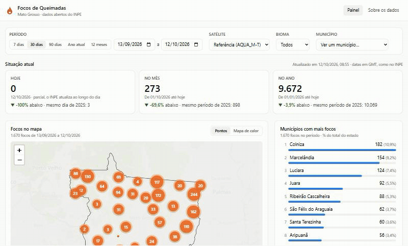

# Focos de Queimadas · Mato Grosso

Painel web dos focos de queimada em Mato Grosso, com dados abertos do INPE coletados automaticamente.



## Funcionalidades

- Mapa dos focos com agrupamento de pontos e mapa de calor
- Filtros por período, satélite e bioma (Amazônia, Cerrado, Pantanal)
- Focos de hoje, do mês e do ano, comparados com o ano anterior
- Ranking dos municípios com mais focos
- Série temporal diária ou mensal, com o mesmo período do ano anterior
- Médias de dias sem chuva e de risco de fogo
- Página de cada município com histórico próprio
- Coleta diária automática dos arquivos do INPE

## Stack

- **Backend:** Laravel 13 (PHP 8.4), API REST, Scheduler e Queues
- **Frontend:** Vue 3, Vite e Tailwind CSS
- **Mapa e gráficos:** Leaflet e Chart.js
- **Banco:** SQLite (desenvolvimento) e PostgreSQL (produção)
- **Testes e CI:** PHPUnit e GitHub Actions
- **Deploy:** Docker (backend) e site estático (frontend)

## Rodando localmente

Requisitos: PHP 8.4+, Composer, Node.js 22+ e Yarn. Backend e frontend rodam separadamente, cada um em um terminal.

**Backend**

```bash
cd backend
composer install
cp .env.example .env
php artisan key:generate
php artisan migrate --seed

php artisan focos:importar --dias=30        # últimos 30 dias (~3 min)
php artisan focos:importar-historico 2025   # ano anterior, para as comparações
php artisan serve
```

**Frontend**

```bash
cd frontend
yarn install
cp .env.example .env
yarn dev
```

## Sobre os dados

Os focos vêm do [Programa Queimadas do INPE](https://terrabrasilis.dpi.inpe.br/queimadas/portal/) e os limites dos municípios, do IBGE.

Os arquivos do INPE misturam vários satélites, então o mesmo fogo pode aparecer mais de uma vez e o total muda conforme os satélites em operação. Para comparar períodos, o INPE usa um único satélite de referência (AQUA, passagem da tarde), e o painel abre com ele selecionado.